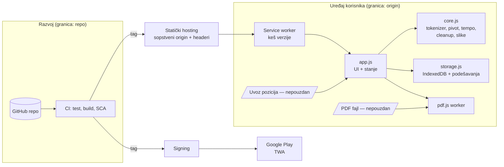

# Arhitektura

Datum: 2026-10-24 · Odnosi se na ciljno stanje posle faze 4. Razlike u odnosu na kod `a44a0e2` su označene sa **[sada]**.

## Komponente i tokovi podataka



**[sada]:**
- sve je u jednom `index.html` (116 KB, inline JS i CSS);
- pdf.js je ručno ubačen u `vendor/`;
- nema CI-ja ni builda;
- fontovi se učitavaju sa Google-a;
- SW verzija se upisuje ručno.

## Moduli (cilj)

| Modul | Odgovornost | Testira se |
|---|---|---|
| `core.js` | Čiste funkcije: `tokenize`, `pivotOf`, `factorOf`, `Book`, `applyCleanup`, `findImageBoxes`, `placeImages` (`index.html:306-759`) | Unit (QA-05), bez DOM-a |
| `player.js` | `Player` scheduler (deadline-based) | Unit sa lažnim satom |
| `storage.js` | IndexedDB šema, migracije, uvoz/izvoz pozicija sa validacijom šeme | Unit (fake-indexeddb) + E2E |
| `pdf.js` adapter | Učitavanje PDF-a, `isEvalSupported:false`, ekstrakcija teksta i slika | Integracioni, sa korpusom PDF-ova |
| `app.js` | UI, događaji, reader, prikaz dokumenta | E2E |
| `sw.js` | Generisan u buildu: lista fajlova i hash verzije | E2E (offline, ažuriranje, rollback) |

## Model podataka (IndexedDB `rsvp-reader`, verzija 1)

| Store | Ključ | Sadržaj | Napomena |
|---|---|---|---|
| `documents` | `id` (SHA-256 PDF-a) | naslov, broj strana i reči, cleanup, slike, `processorVersion` | Isti PDF na dva uređaja ima isti `id` |
| `files` | `docId` | originalni PDF blob | Potreban za prikaz stranice i reprocess |
| `pages` | `[docId, pageIndex]` | tekst + `Uint32Array`/`Uint8Array` tokena | Najveći store |
| `progress` | `docId` | `tokenIndex`, `updatedAt` | Indeks reči je stabilan između `PROCESSOR_VERSION` verzija (`index.html:1254`) |
| localStorage `rsvp-settings` | — | wpm, sent, skipRunning, showImages | Validirati pri čitanju (P2) |

**Integritet (ARH-01):**
- Brisanje knjige je jedna transakcija.
- Uvoz upisuje `pages` u serijama po 40, a `documents` i `files` na kraju. Prekid ostavlja siroče `pages`, koje `cleanOrphans()` čisti pri startu (`index.html:1997`).
- Ovo treba pokriti testom prekida (T1.5).

**Migracije (ARH-02):**
- Šema je u `src/storage.js` (`MIGRATIONS`, jedna funkcija po verziji). Pokreću se samo nedostajuće migracije, sve unutar jedne upgrade transakcije, pa greška vraća bazu na prethodnu verziju bez gubitka podataka.
- Otvoren stari tab sam zatvara konekciju (`versionchange`) i ne blokira nadogradnju.
- Posle rollback-a aplikacije novija baza se otvara na svojoj verziji, bez izmena (INF-04).
- Ispravljeno 2026-10-25; ranije je kod kreirao store-ove bez grananja po verziji, što bi puklo već kod verzije 2.
- `PROCESSOR_VERSION` pokreće reprocess iz sačuvanog PDF-a.

## Granice poverenja

1. **PDF → pdf.js worker:** sav sadržaj fajla je nepouzdan (threat model P1).
2. **Clipboard JSON → storage:** nepouzdan (P2).
3. **Origin:** sve na istom origin-u ima pun pristup podacima (P4) → sopstveni origin (ADR 0003).
4. **Repo → CI → hosting/prodavnice:** integritet isporuke (P3).

## Ciljni sigurnosni headeri (hosting koji podržava sopstvene headere)

```
Content-Security-Policy: default-src 'self'; script-src 'self'; style-src 'self'; img-src 'self' blob: data:; font-src 'self'; connect-src 'self'; worker-src 'self'; object-src 'none'; base-uri 'none'; form-action 'none'; frame-ancestors 'none'
Strict-Transport-Security: max-age=31536000
X-Content-Type-Options: nosniff
Referrer-Policy: no-referrer
Permissions-Policy: camera=(), microphone=(), geolocation=()
```

Kompatibilnost sa pdf.js (canvas, text layer, fontovi iz PDF-a) i sa TWA omotačem **treba proveriti u fazi 4**. Ovo je cilj, ne potvrđena konfiguracija.

**Stvarna konfiguracija od 2026-10-27:** `hosting/_headers` (Cloudflare Pages). Pod njom prolaze svi browser testovi (`tests/e2e/csp.py`). TWA omotač još nije proveren.

Dopuna 2026-10-25 (pdf.js 6, ADR 0005): `script-src` mora sadržati i `'wasm-unsafe-eval'` za dekodere slika (JPEG 2000, JBIG2, ICC). To nije `unsafe-eval`.
